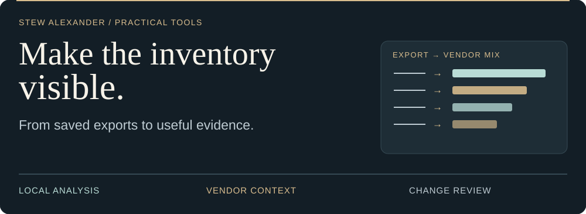
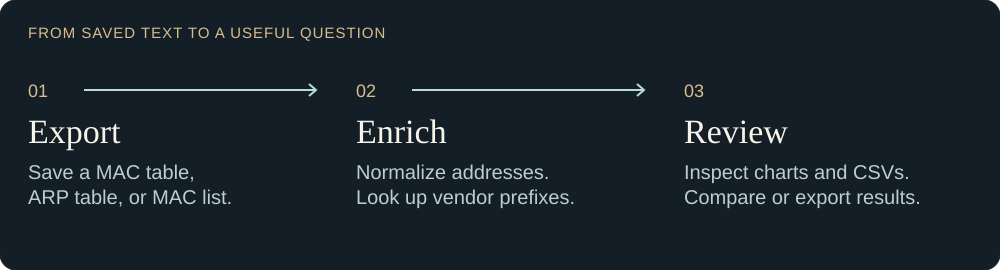
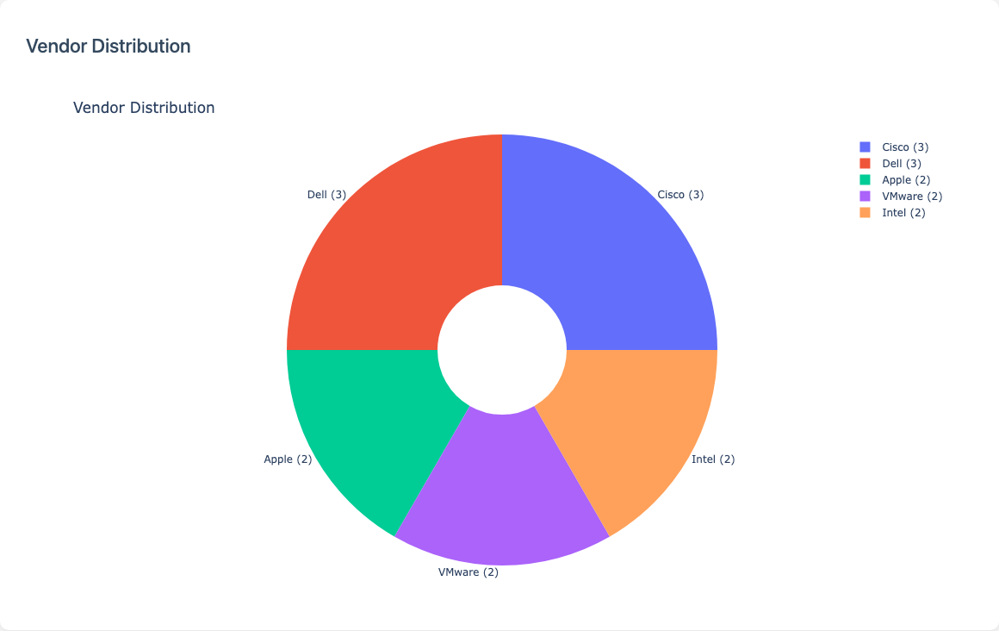
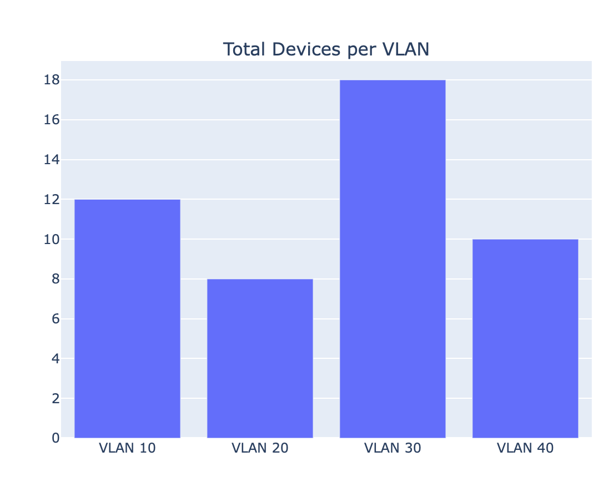
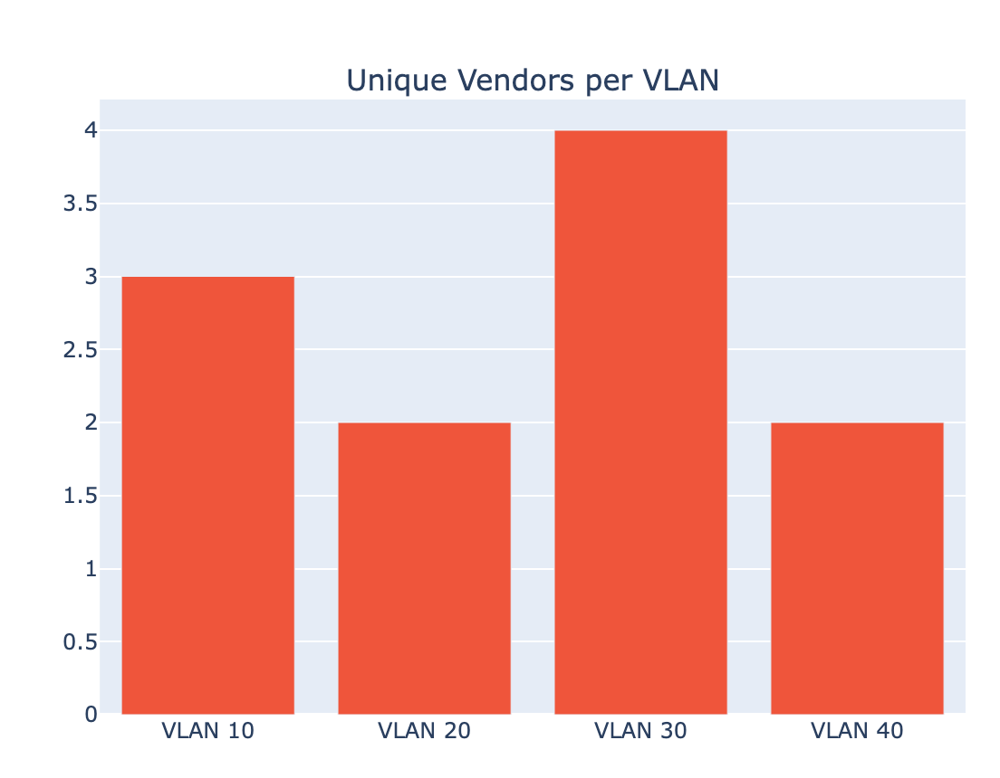
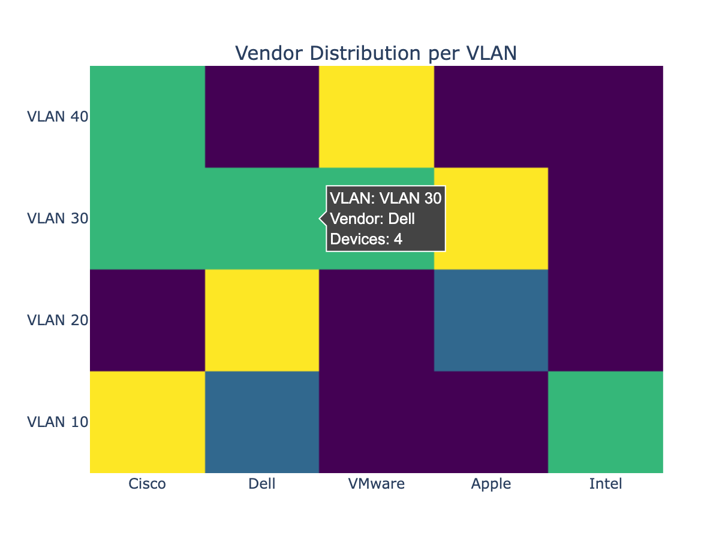
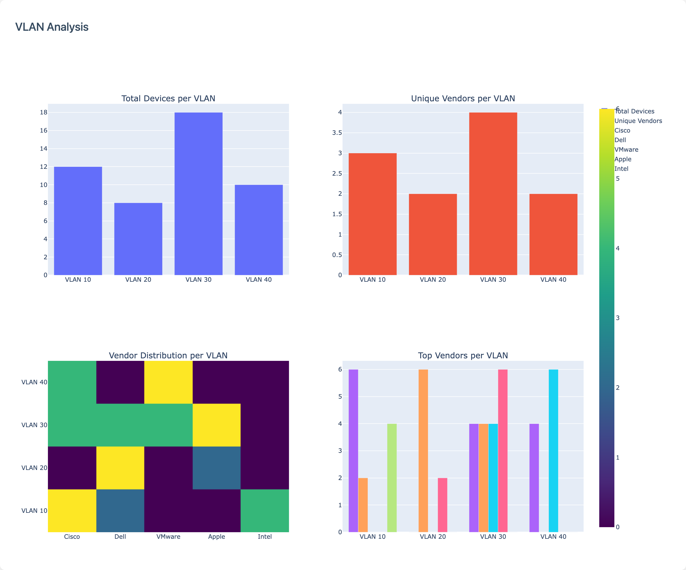
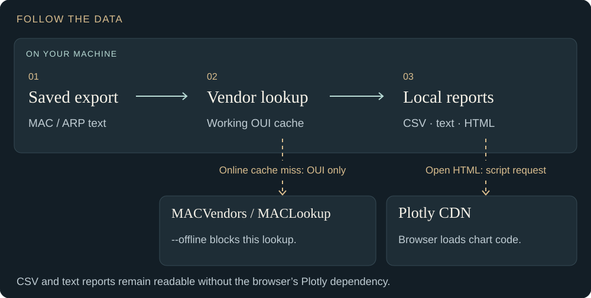

<picture>
  <source media="(max-width: 600px)" srcset="docs/readme-assets/hero-mobile.svg">
  
</picture>

# ShadowVendor

**Turn network exports into a clearer picture of your device vendors.**

ShadowVendor reads saved MAC address tables, ARP tables, and MAC lists. It identifies vendors from address prefixes and produces interactive HTML charts, CSV reports, and timestamped summaries. Use those outputs to review a change window, investigate an unfamiliar vendor, or feed your SIEM.

[Try the sample](#quick-start) · [See the output](#see-the-output) · [Data boundaries](#what-stays-local) · [Documentation](#go-further)

**Scope:** analysis of saved text files. ShadowVendor does not scan your network or connect to switches. A vendor match is a clue about an address prefix, not proof of device identity, ownership, or compromise.

## From an export to evidence

<picture>
  <source media="(max-width: 600px)" srcset="docs/readme-assets/workflow-mobile.svg">
  
</picture>

| Your question | Where to look |
| --- | --- |
| Which vendors appear in this export? | Vendor distribution chart and device CSV |
| How are those entries spread across VLANs and ports? | VLAN charts and, for MAC tables, the port report |
| Has the vendor mix changed? | Archived summaries and the drift CSV |
| How can I correlate this with other events? | CSV/JSONL exports tagged with site and environment |

Drift shows changes in aggregate vendor percentages. Alert rules, collection schedules, and device-level comparisons belong in your surrounding workflow or SIEM.

## Quick start

Use **Python 3.11 or newer** for this walkthrough. Run these commands from a terminal on macOS or Linux:

```bash
git clone https://github.com/StewAlexander-com/ShadowVendor.git
cd ShadowVendor
python3 -m venv .venv
source .venv/bin/activate
python -m pip install -r requirements.txt
```

Seed the working cache from the repository’s bundled snapshot. This first-use step keeps the sample run offline and preserves any existing cache:

```bash
mkdir -p output/data
cp -n shadowvendor/data/oui_cache.json output/data/oui_cache.json
python ShadowVendor.py --offline docs/examples/mac-table.txt
```

Open **`output/vendor_distribution.html`** in your browser. With the bundled cache, the synthetic sample produces **12 unique MAC entries, 5 vendor labels, and 4 VLANs**. The included addresses are demonstration data, not a captured network inventory.

**Two separate network boundaries:** dependency installation needs internet access; `--offline` disables vendor lookup requests during analysis. Opening the generated dashboard still loads Plotly from a CDN. CSV and text reports remain usable without that browser dependency.

<details>
<summary><strong>Windows PowerShell setup</strong></summary>

Use Python 3.11+ and run the environment’s interpreter directly; no activation-policy change is needed.

```powershell
git clone https://github.com/StewAlexander-com/ShadowVendor.git
cd ShadowVendor
py -3 -m venv .venv
.\.venv\Scripts\python.exe -m pip install -r requirements.txt
New-Item -ItemType Directory -Force output/data | Out-Null
if (!(Test-Path output/data/oui_cache.json)) {
    Copy-Item shadowvendor/data/oui_cache.json output/data/oui_cache.json
}
.\.venv\Scripts\python.exe ShadowVendor.py --offline docs/examples/mac-table.txt
```

Open `output/vendor_distribution.html` in your browser. The same CDN requirement applies.

</details>

## See the output

Actual dashboard output from the 12-entry synthetic sample above, using the bundled cache. The README artwork illustrates the workflow; these captures show the application as it is.

[](docs/readme-assets/dashboard.png)

Hover over a chart segment to inspect counts and percentages. Open the image at full size for its labels; the generated HTML provides the interactive view.

### Look closer at VLANs

These additional graphs come directly from ShadowVendor running the [48-entry synthetic VLAN example](docs/examples/vlan-review.txt). They are cropped captures of the generated dashboard, with its original chart styling and values.

**Where are entries concentrated?** VLAN 30 has 18 unique MAC entries; VLANs 10, 20, and 40 have 12, 8, and 10 respectively.

<a href="docs/readme-assets/vlan-device-count.png"></a>

**How varied is each VLAN?** The same export contains 3, 2, 4, and 2 vendor labels across those VLANs. Diversity adds context; it is not a security score.

<a href="docs/readme-assets/vlan-vendor-diversity.png"></a>

**Which vendor appears where?** The heatmap reveals the mix behind the totals. This capture shows the application's hover detail: **four Dell entries in VLAN 30**. Colors represent entry counts, from purple (0) to yellow (6) in this example.

<a href="docs/readme-assets/vendor-vlan-heatmap.png"></a>

<details>
<summary><strong>Open the complete four-chart dashboard and reproduce it</strong></summary>

[](docs/readme-assets/vlan-review-dashboard.png)

After the quick-start installation and cache setup:

```bash
python ShadowVendor.py --offline docs/examples/vlan-review.txt
```

Open `output/vendor_distribution.html`. This replaces the previous sample's dashboard and summary. The new example has **48 unique MAC entries, 5 vendor labels, and 4 VLANs**. These are demonstration addresses, not a production network capture.

The [original 12-entry sample's VLAN dashboard](docs/readme-assets/vlan-analysis.png) is also available. VLAN and port detail depends on what the input contains and the parser recognizes; missing fields appear as `N/A`.

</details>

| Report | What it contains |
| --- | --- |
| Device CSV | Unique MAC entries with vendor, VLAN, and port |
| Port CSV | Port grouping for MAC-table inputs |
| HTML dashboard | Vendor and VLAN charts |
| Text summary | Vendor counts and percentages |
| History archive | Timestamped summary and metadata, saved by default |

<details>
<summary><strong>Where the sample files are saved</strong></summary>

```text
output/
├── mac-table-Devices.csv
├── mac-table-Ports.csv
├── vendor_distribution.html
└── vendor_summary.txt
history/
└── timestamped summaries
    and companion metadata
```

Device and port filenames use the input filename without its extension. See the [usage reference](docs/usage.md) for optional exports and archive naming.

</details>

Shared output filenames are overwritten on later runs; archive reports you need to retain. Duplicate MAC addresses collapse to one entry, so counts describe unique addresses in the supplied file.

## What stays local

<picture>
  <source media="(max-width: 600px)" srcset="docs/readme-assets/data-boundaries-mobile.svg">
  
</picture>

Input files and full MAC addresses are processed locally. In default online mode, uncached prefixes may be sent to **MACVendors** or **MACLookup**. Use `--offline` when external vendor lookups are unwanted. An uncached prefix becomes `Unknown`.

The script reads its working cache from `output/data/oui_cache.json`; it does not automatically load the bundled snapshot. Cache age and randomized or spoofed MAC addresses limit what vendor labels can establish. Treat generated reports as network inventory data when sharing them.

## Put it to work

Replace the sample path with your own saved export. Use **`ShadowVendor.py` for these flags**; `shadowvendor` and `python -m shadowvendor` are basic file-only entry points.

**Review a change window** — keep comparable exports from the same scope together:

```bash
python ShadowVendor.py --offline \
  --history-dir history/DC1 --analyze-drift \
  --site DC1 --change-ticket CHG-12345 my-switch.txt
```

This adds the latest summary to the archive and writes `history/DC1/vendor_drift.csv`. Two or more comparable snapshots make a trend meaningful; a percentage shift alone does not explain its cause.

**Prepare SIEM ingestion** — export locally, then configure your collector separately:

```bash
python ShadowVendor.py --offline --siem-export \
  --site DC1 --environment prod my-switch.txt
```

Read `output/siem/shadowvendor_siem.csv` or `output/siem/shadowvendor_siem.json`. The `.json` file contains **JSON Lines**, one event per line. Exporting does not send events to a SIEM.

## Go further

| Next step | Guide |
| --- | --- |
| Flags, input examples, cache behavior, output details | [Usage reference](docs/usage.md) |
| Recurring jobs and configuration formats | [Configuration](CONFIG.md) |
| SIEM ingestion and operational patterns | [Advanced guide](ADVANCED.md) |
| Architecture and the Python API | [Technical tutorial](TUTORIAL.md) · [API source](shadowvendor/api.py) |
| Execution paths and existing tests | [Execution paths](EXECUTION_PATHS.md) · [Test coverage](TEST_COVERAGE.md) |

The [usage reference](docs/usage.md) records current implementation limits where older guides describe broader behavior.

## Contribute or get help

Open an [issue](https://github.com/StewAlexander-com/ShadowVendor/issues) with the command, Python version, and a sanitized input example. For a code contribution, include a focused regression test and run `python -m pytest tests` after installing `requirements-dev.txt`. See [SECURITY.md](SECURITY.md) for private vulnerability reporting.

## License and author

[MIT License](LICENSE) · Copyright © 2024–2026 Stewart Alexander.

Created by [Stewart Alexander](https://www.stewalexander.com/) — independent thinking, practical work.
